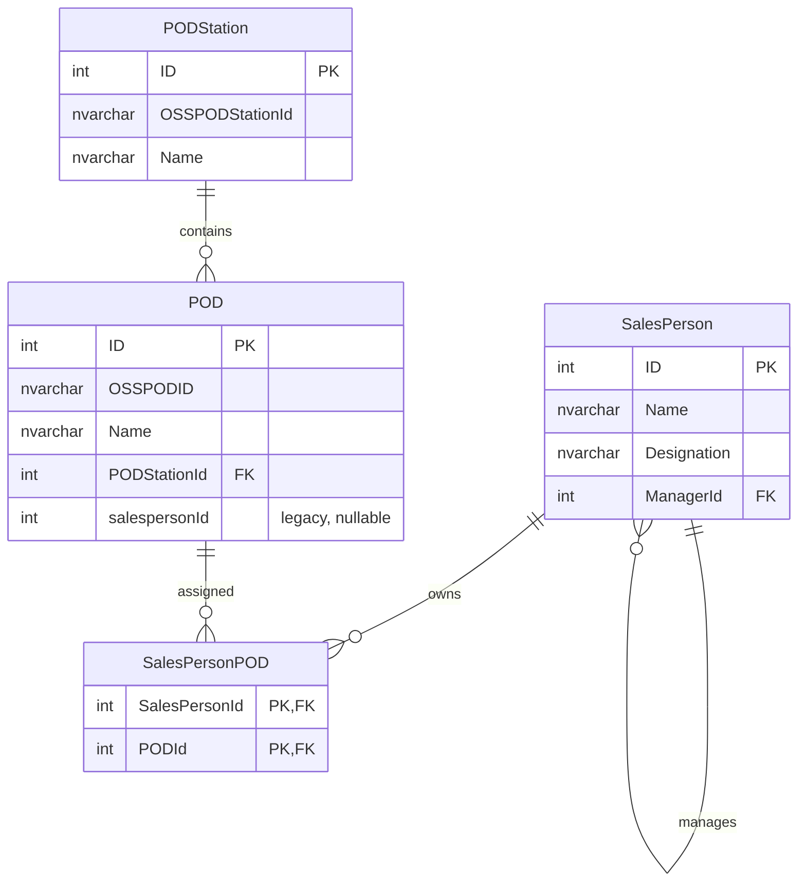
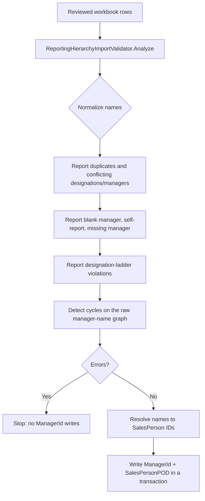

# Reporting Hierarchy + POD Assignment — Implementation Report

## 1. Status

Implemented and verified in the existing `SalesHierarchy.slnx` solution:

- Designation-aware reporting-manager validation (self-reporting, cycles, existence, ladder compatibility).
- `dbo.SalesPersonPOD` many-to-many assignment table, with an idempotent upgrade script.
- Transactional salesperson create/update plus POD mapping sync.
- Searchable POD multi-select with removable tags on the Admin create/edit screens.
- Idempotent, review-first PODStation and POD seed scripts.
- Unit/behavior tests for validation, deduplication, diffing, and import review.
- Reviewed workbook import applied to the local `SalesProdAuthDb` on 2026-10-29.

Source workbooks reviewed:

- `D:\SalesHierarchy\pods.xlsx` (`pod` and `station` sheets).
- `D:\SalesHierarchy\Sales Mapping With Dealer and POD.xlsx` (`Sheet1`).

Imported:

- 73 POD stations.
- 208 PODs with a verified POD-to-station pair. The other 65 PODs in `pods.xlsx` have no station in either workbook and remain unimported because `POD.PODStationId` is `NOT NULL`.
- 34 salespeople: 4 CXO, 2 Head, 9 Sales Manager/Supervisor, 19 Sales Officer.
- 208 POD assignments to the row's Sales Officer.
- 40 dealer records and 67 dealer-to-officer mappings. Dealer codes are used as both `Name` and `Code` because the workbook has no dealer names.

Review exceptions intentionally left unresolved:

- `Bipindra Neupane` (Head) appears under 3 CXOs.
- `Ujjwol Neupane` (Head) appears under 3 CXOs.
- `Hritik Mishra` (Sales Officer) appears under 2 managers.

Those 3 manager links were left `NULL` and reported instead of picking a parent. No IDs, names, managers, PODs, stations, or dealer codes were invented. Existing/demo rows were not overwritten or deleted.

## 2. Schema



`SalesPersonPOD` is the source of truth for multi-POD ownership. The legacy `POD.salespersonId` column is retained; reads union both sources, and writes sync the legacy value only when it is null or already owned by the same salesperson.

## 3. Reporting rules

| Designation | Expected manager level | Notes |
|---|---|---|
| `CXO` | None | Must not have a reporting manager |
| `Head` | `CXO` | Manager may not be blank |
| `Sales Manager`, `Supervisor`, `Sales Manager/Supervisor`, `Sales Manager / Supervisor` | `Head` | Same level for hierarchy purposes |
| `Sales Officer` | `Manager` | Includes the three manager-level spellings above |
| Any other/custom designation | Not restricted | Legacy flexibility; still checked for existence, self-reporting, and cycles |

Server-side validation in `HierarchyValidator.ValidateAssignment` rejects:

1. Self-reporting.
2. A manager ID that does not exist.
3. An assignment that would create a cycle, including an existing cycle in loaded data.
4. A manager whose designation is not allowed for the salesperson's designation.
5. A CXO with a manager, or a ladder designation with no manager.

The client-side manager filter and `data-designation-map` are usability aids only; the same rules are re-run on POST.

## 4. Import/review flow



Cycle detection deliberately runs on the raw manager-name graph. A cycle that also violates the designation ladder must still be reported instead of being dropped with the rejected edge.

## 5. Data review status

Source files were supplied in the repository root and inspected read-only before any write:

- `pods.xlsx`
- `Sales Mapping With Dealer and POD.xlsx`

The earlier expected filename `Sales Mapping With Dealer and POD(1).xlsx` was not present; the supplied file without `(1)` is the one that was reviewed.

Local database inventory before the import (`SalesProdAuthDb`, read-only inspection):

| Table | Rows |
|---|---:|
| `PODStation` | 2 |
| `POD` | 3 |
| `SalesPerson` | 4 |
| `Dealer` | 4 |
| `salesdealermapping` | 4 |
| `POD` rows with legacy `salespersonId` | 3 |
| `SalesPersonPOD` | table did not exist before this change |

Inventory after the import and one idempotent re-run:

| Table | Rows |
|---|---:|
| `PODStation` | 75 (2 existing + 73 imported) |
| `POD` | 211 (3 existing + 208 imported) |
| `SalesPerson` | 38 (4 existing + 34 imported) |
| `SalesPersonPOD` | 211 (3 migrated legacy + 208 imported) |
| `Dealer` | 44 (4 existing + 40 imported) |
| `salesdealermapping` | 71 (4 existing + 67 imported) |

| Source | Imported | Review rows | Result |
|---|---:|---:|---|
| Reporting hierarchy workbook | 34 people / 208 POD rows | 3 | Imported. Conflicting manager links left `NULL`. |
| `pods.xlsx` station sheet | 73 | 2 | Imported all stations. Two mapping rows spell `Trisuli`; normalized to the station master's `Trishuli POD Station`. |
| `pods.xlsx` POD sheet | 208 of 273 | 65 | Imported only PODs with a verified station. The remaining 65 are reported, not guessed. |
| Dealer column | 40 dealers / 67 pairs | 0 | Imported with `Name = Code`; each dealer is mapped to every Sales Officer who serves it. |
| Legacy `POD.salespersonId` | 3 existing + 208 new | 0 | Existing 3 migrated by the upgrade; 208 new values synced to the Sales Officer. |

`Sanjib karki` and `Sanjib Karki` were normalized to one person, `Sanjib Karki`. The 71 review rows comprise 2 station aliases, 3 hierarchy conflicts, 1 name normalization, and 65 skipped PODs.

Unresolved hierarchy links:

| Person | Designation | Candidates in the workbook | Result |
|---|---|---|---|
| `Bipindra Neupane` | Head | `Ramesh Sapkota`, `Surya Bdr Bogati`, `Sushil Rana Thapa` | `ManagerId` left `NULL` |
| `Ujjwol Neupane` | Head | `Mahendra Bd Kc`, `Ramesh Sapkota`, `Sushil Rana Thapa` | `ManagerId` left `NULL` |
| `Hritik Mishra` | Sales Officer | `Niranjan Shah` (10 rows), `Nirmal Acharya` (1 row) | `ManagerId` left `NULL` |

Correct these in Admin → Sales Persons after confirming the real reporting lines. The import remains idempotent, so re-running it will not overwrite a manager you set manually.

## 6. Verification

```text
dotnet build SalesHierarchy.slnx --nologo
Build succeeded. 0 Warning(s), 0 Error(s)

dotnet test SalesHierarchy.slnx --nologo
Passed! Failed: 0, Passed: 58, Skipped: 0, Total: 58
```

The full import was first dry-run inside an outer transaction and rolled back. The dry run produced the same counts later observed after the real run, and left the database unchanged.

SQL upgrade dry run (the whole migration was rolled back afterwards, leaving the database unchanged):

```sql
-- verify-salespersonpod-migration.sql
SET NOCOUNT ON;
BEGIN TRANSACTION;
:r .\database\Upgrade-SalesPersonPOD.sql
SELECT COUNT(*) AS MigratedMappings FROM dbo.SalesPersonPOD;
ROLLBACK TRANSACTION;
SELECT OBJECT_ID(N'dbo.SalesPersonPOD', N'U') AS ObjectIdAfterRollback;
```

```powershell
sqlcmd -S localhost -E -C -b -d SalesProdAuthDb -i .\verify-salespersonpod-migration.sql
```

Observed inside the transaction: 3 legacy assignments migrated into `SalesPersonPOD`; after `ROLLBACK`, `OBJECT_ID(N'dbo.SalesPersonPOD', N'U')` was `NULL` again.

The reviewed import was applied with the upgrade first:

```powershell
sqlcmd -S localhost -E -C -b -d SalesProdAuthDb -i .\database\Upgrade-SalesPersonPOD.sql
sqlcmd -S localhost -E -C -b -d SalesProdAuthDb -i .\database\SalesHierarchy.Database\Scripts\Import-ReviewedSalesData.sql
```

The import's review report contained the expected 71 rows (2 station aliases, 3 hierarchy conflicts, 1 name normalization, 65 skipped PODs). It did not report any name/ID collisions. Re-running the import left all counts unchanged:

```text
PODStations PODs SalesPeople SalesPersonPODs Dealers DealerMappings
75          211  38          211             44      71
```

Additional checks:

| Check | Result |
|---|---:|
| Workbook PODs with exactly one Sales Officer owner | 208 |
| Workbook PODs with multiple owners | 0 |
| Workbook PODs missing a mapping | 0 |
| Workbook PODs with legacy owner synced to the officer | 208 |
| Dealer mappings pointing at a Sales Officer | 67 |
| Dealers without any mapping | 0 |
| Duplicate station names / source IDs | 0 / 0 |
| Duplicate POD names / source IDs | 0 / 0 |
| Duplicate dealer codes | 0 |
| Duplicate salesperson names | 0 |
| Duplicate dealer mappings | 0 |
| Invalid ladder links | 3 (the documented unresolved conflicts only) |

The SSDT `.sqlproj` build could not be run here (`MSB4057: The target "Build" does not exist`) because the SQL Server Data Tools/SSDT build target is not installed in this environment. The `dotnet build` of the application solution is clean.

## 7. Manual SQL steps

Run these against the target database after taking a backup.

### 7.1 Create/upgrade the join table and migrate legacy owners

```powershell
sqlcmd -S <server> -E -C -b -d SalesProdAuthDb -i .\database\Upgrade-SalesPersonPOD.sql
```

Verify:

```sql
SELECT COUNT(*) AS Mappings FROM dbo.SalesPersonPOD;

SELECT p.ID, p.Name, p.salespersonId AS LegacyOwner,
       m.SalesPersonId AS ManyToManyOwner
FROM dbo.POD AS p
LEFT JOIN dbo.SalesPersonPOD AS m ON m.PODId = p.ID
WHERE p.salespersonId IS NOT NULL
ORDER BY p.ID;

SELECT PODId, COUNT(*) AS Owners
FROM dbo.SalesPersonPOD
GROUP BY PODId
HAVING COUNT(*) > 1;
```

The last query is informative only: a POD may intentionally be assigned to more than one salesperson by the many-to-many model.

### 7.2 Seed POD stations and PODs

`PODStation.Seed.sql` and `POD.Seed.sql` remain generic templates for future reviewed batches. The current workbook data was applied with the generated import script in section 7.4.

1. Open `database/SalesHierarchy.Database/Scripts/PODStation.Seed.sql`.
2. Paste reviewed `pods.xlsx` station rows into `@Source`.
3. Run it and review the conflict report (existing names are never overwritten).
4. Open `POD.Seed.sql`.
5. Paste reviewed POD rows into `@Source`, including the external `OSSPODStationId`.
6. Run it and review:
   - `Missing or unknown station` rows: these are not inserted because `POD.PODStationId` is `NOT NULL`.
   - Existing-row differences: reported, never overwritten.
7. Re-run either script to confirm it is idempotent.

```powershell
sqlcmd -S <server> -E -C -b -d SalesProdAuthDb -i .\database\SalesHierarchy.Database\Scripts\PODStation.Seed.sql
sqlcmd -S <server> -E -C -b -d SalesProdAuthDb -i .\database\SalesHierarchy.Database\Scripts\POD.Seed.sql
```

### 7.3 Review a proposed hierarchy import before writing

Use `ReportingHierarchyImportValidator.Analyze(...)` with rows read from the reviewed workbook. Do not write `ManagerId` when `report.HasErrors` is true. Persist `report.ManagerNameByPerson` only after resolving every name to a unique `SalesPerson.ID`.

### 7.4 Apply the reviewed workbook import

The generated script contains the exact reviewed rows, review report, and conflict checks. It requires the `SalesPersonPOD` table from section 7.1.

```powershell
sqlcmd -S <server> -E -C -b -d SalesProdAuthDb -i .\database\SalesHierarchy.Database\Scripts\Import-ReviewedSalesData.sql
```

What it does:

1. Inserts missing POD stations, matching on source station ID or name.
2. Inserts only PODs with a verified station, matching on source POD ID or name.
3. Inserts the 34 salespeople and resolves unambiguous manager links.
4. Assigns each POD to its Sales Officer in `SalesPersonPOD` and syncs the legacy `POD.salespersonId` when safe.
5. Creates missing dealers (`Name = Code`) and dealer-to-officer mappings.
6. Prints the review report and final table counts.

It never updates an existing station/POD/dealer name, designation, or owner. Re-running it is safe. The 3 conflicting manager links stay `NULL` until corrected manually.

Verify after running with the read-only verification script:

```powershell
sqlcmd -S <server> -E -C -b -d SalesProdAuthDb -i .\database\Verify-ReviewedImport.sql
```

Expected on the reviewed local database:

- Counts: `PODStations=75`, `PODs=211`, `SalesPeople=38`, `SalesPersonPODs=211`, `Dealers=44`, `DealerMappings=71`.
- Exactly the 3 documented ladder exceptions, all with `ManagerId = NULL`.
- `208` workbook PODs, each with exactly one owner; `208` owned by a Sales Officer; `208` with the legacy owner synced.
- `67` workbook dealer mappings, all to Sales Officers.
- No duplicate station names/source IDs, POD names/source IDs, dealer codes, salesperson names, or dealer mappings.

## 8. Manual UI checks

- Admin → Sales Persons → New: designation changes filter the manager list; a CXO shows no manager choices.
- Submitting a forged incompatible manager ID shows a server-side error.
- POD picker: type to filter by name, OSS ID, or station; selected items become removable chips; removing a chip removes the hidden `PODIds` input.
- Create with zero PODs, one POD, and many PODs.
- Edit: existing PODs are preselected; removing all PODs and saving clears the mappings.
- Submitting a deleted POD ID or a duplicate ID: duplicates collapse; a missing POD is rejected before any salesperson write.
- Legacy owner check: assigning a POD to a second salesperson does not silently overwrite another salesperson's legacy `POD.salespersonId`.

## 9. Key files

| Area | Files |
|---|---|
| Join table + migration | `database/SalesHierarchy.Database/Tables/SalesPersonPOD.sql`, `database/Upgrade-SalesPersonPOD.sql`, `database/SalesHierarchy.Database/Scripts/SalesPersonPOD.Migration.sql` |
| Seed/review scripts | `database/SalesHierarchy.Database/Scripts/PODStation.Seed.sql`, `database/SalesHierarchy.Database/Scripts/POD.Seed.sql`, `database/SalesHierarchy.Database/Scripts/Import-ReviewedSalesData.sql` |
| Import verification | `database/Verify-ReviewedImport.sql` |
| Rules | `src/SalesHierarchy.Core/Validation/HierarchyValidator.cs`, `ReportingHierarchyImportValidator.cs`, `PODAssignment.cs` |
| Persistence | `src/SalesHierarchy.Infrastructure/Repositories/SalesPersonRepository.cs`, `PODRepository.cs` |
| UI | `src/SalesHierarchy.Web/Controllers/AdminController.cs`, `ViewModels/SalesPersonFormViewModel.cs`, `Views/Admin/CreateSalesPerson.cshtml`, `Views/Admin/EditSalesPerson.cshtml`, `wwwroot/js/pod-multiselect.js`, `wwwroot/js/hierarchy-form.js`, `wwwroot/css/pod-multiselect.css` |
| Tests | `src/SalesHierarchy.Tests/HierarchyValidatorTests.cs`, `PODAssignmentTests.cs`, `ReportingHierarchyImportValidatorTests.cs` |
